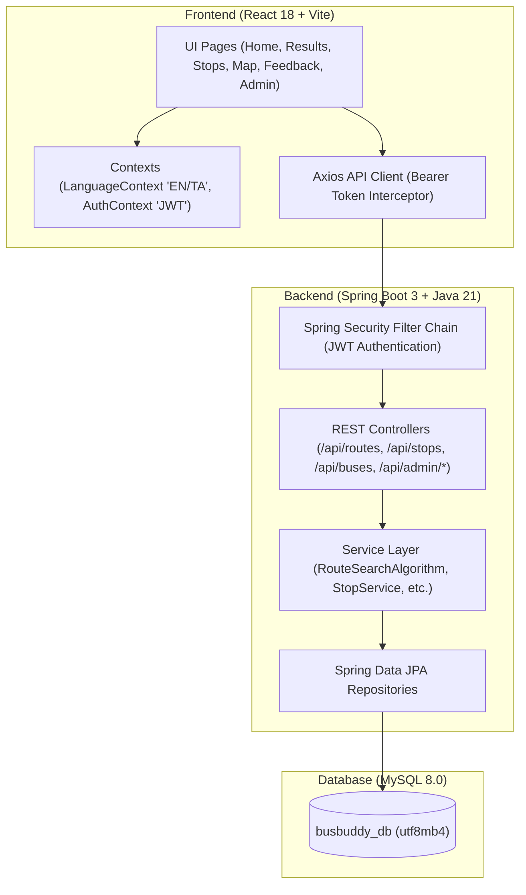
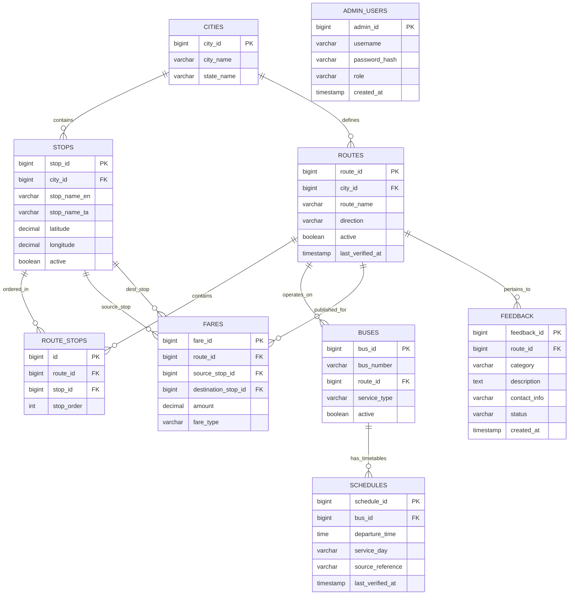

# BusBuddy — Smart Local Bus Information System

> **A College Java Full Stack Mini Project for Tamil Nadu Public Transportation Discovery**  
> Built with **React 18 + Vite**, **Java 21 + Spring Boot 3**, **Spring Security (JWT)**, and **MySQL 8.0**.

---

## 1. Project Overview & Objective

**BusBuddy** is a real-world, full-stack transit web application designed to help passengers navigate local bus networks in Tamil Nadu (pilot city: **Coimbatore**). It enables commuters to:

- Search for buses between any boarding and destination stop.
- Find **direct bus routes** with ordered intermediate stops and timetables.
- Identify **connecting bus routes with exactly one transfer** when no direct service exists.
- Search bus routes and schedules by **bus number** (e.g., 11A, 70, 33A, 90A, 102, 20C, 45B).
- View bus stops and route sequences on an interactive **Leaflet + OpenStreetMap**.
- Switch seamlessly between **English and Tamil (தமிழ்)** for all stop names, routes, and UI controls.
- Submit public feedback and correction reports to transport administrators.
- Manage stops, routes, buses, timetables, fares, and feedback via a secure **Transport Admin Portal**.

---

## 2. Technology Stack

| Layer | Technologies |
| :--- | :--- |
| **Frontend** | React 18, Vite, JavaScript (JSX), CSS3 (Custom Design System), React Router v6, Axios, Lucide React, Leaflet.js, React-Leaflet |
| **Backend** | Java 21, Spring Boot 3.3.4, Spring Web, Spring Data JPA, Hibernate ORM, Spring Security, JJWT 0.12.6, Jakarta Bean Validation, Maven |
| **Database** | MySQL 8.0+, utf8mb4 character set (Full Tamil Unicode support), Relational foreign keys and indexes |
| **Development** | IntelliJ IDEA / VS Code compatible, Postman-compatible REST APIs, JUnit 5 + Spring Boot Test |

---

## 3. System Architecture & Diagrams

### 3.1 Layered Architecture


### 3.2 Database Entity-Relationship Diagram (ERD)


---

## 4. Core Java Route Search Algorithm

The heart of BusBuddy is implemented in Java (`com.busbuddy.service.impl.RouteServiceImpl`). It does not use external routing engines or AI models; instead, it leverages relational graph traversal and ordered stop sequences:

### Direct Bus Algorithm
1. **Input Validation:** Verifies that both `sourceStopId` and `destinationStopId` exist and are not identical.
2. **Stop Matching:** Queries active route stops containing `sourceStopId` ($O_s$) and `destinationStopId` ($O_d$).
3. **Sequence Order Verification:** A route is accepted **if and only if $O_s < O_d$**. Reverse-direction services are treated as separate directional records.
4. **Intermediate Extraction:** Slices all stops along the route between $O_s$ and $O_d$ inclusive.
5. **Bus & Schedule Association:** Fetches registered bus fleet numbers, departure schedules, and published fare amount.

### Connecting Bus Algorithm (1 Transfer)
When a passenger needs to travel between two stops without direct service:
1. **Leg 1 Candidate Discovery:** Finds all active routes $R_1$ passing through source $S$ at order $O_{1,S}$.
2. **Transfer Stop Candidates:** All stops $T$ on $R_1$ where $O_{1,T} > O_{1,S}$ are candidate transfer hubs ($T \ne S$ and $T \ne D$).
3. **Leg 2 Matching:** For each transfer candidate $T$, queries active routes $R_2$ that contain $T$ at order $O_{2,T}$ and destination $D$ at order $O_{2,D}$.
4. **Validation Rules:**
   - **Different Route Rule:** $R_1.id \ne R_2.id$.
   - **Forward Order Rule:** $O_{2,T} < O_{2,D}$.
   - **Loop Prevention:** Checks that $R_2$ does not visit source $S$ before reaching $D$.
   - **Duplicate Elimination:** Merges identical route combinations $(R_1, T, R_2)$.
5. **Two-Leg Journey Construction:** Assembles `firstLeg` ($S \to T$) and `secondLeg` ($T \to D$), computes total intermediate stops and combined fare, and attaches an academic disclaimer.

---

## 5. REST API Specification

### Public APIs
| Method | Endpoint | Description |
| :--- | :--- | :--- |
| `GET` | `/api/cities` | List supported cities |
| `GET` | `/api/stops` | Directory of all active bus stops |
| `GET` | `/api/stops/popular` | Most connected terminus stops for quick search |
| `GET` | `/api/stops/search?query=` | Search stops in English or Tamil |
| `GET` | `/api/stops/{id}` | Detailed stop metadata and GPS coordinates |
| `GET` | `/api/routes` | List all routes |
| `GET` | `/api/routes/search?sourceId=&destinationId=` | **Core route search (Direct + 1-Transfer)** |
| `GET` | `/api/routes/{id}` | Route details with ordered stops & timetables |
| `GET` | `/api/routes/{id}/stops` | Sequence of stops along a route |
| `GET` | `/api/routes/{id}/schedules` | Scheduled departures for a route |
| `GET` | `/api/buses` | Fleet directory |
| `GET` | `/api/buses/search?number=` | Search buses by number (e.g. `11A`, `70`) |
| `POST` | `/api/feedback` | Submit passenger feedback or correction report |
| `POST` | `/api/auth/login` | Administrator authentication (Returns JWT) |

### Protected Admin APIs (`Authorization: Bearer <token>`)
| Method | Endpoint | Description |
| :--- | :--- | :--- |
| `GET` | `/api/admin/dashboard` | KPI statistics & recent feedback |
| `POST` | `/api/admin/stops` | Register a new bus stop |
| `PUT` | `/api/admin/stops/{id}` | Update existing bus stop |
| `DELETE` | `/api/admin/stops/{id}` | Remove a bus stop |
| `POST` | `/api/admin/routes` | Create route with ordered stop sequence |
| `PUT` | `/api/admin/routes/{id}` | Update route alignment and stop order |
| `DELETE` | `/api/admin/routes/{id}` | Remove a route |
| `POST` | `/api/admin/buses` | Register new bus in fleet |
| `PUT` | `/api/admin/buses/{id}` | Update bus details |
| `DELETE` | `/api/admin/buses/{id}` | Remove bus |
| `GET` | `/api/admin/schedules` | List all timetables |
| `POST` | `/api/admin/schedules` | Create departure schedule |
| `PUT` | `/api/admin/schedules/{id}` | Update departure time |
| `DELETE` | `/api/admin/schedules/{id}` | Remove schedule |
| `GET` | `/api/admin/fares` | List published fares |
| `POST` | `/api/admin/fares` | Create fare stage |
| `PUT` | `/api/admin/fares/{id}` | Update fare |
| `DELETE` | `/api/admin/fares/{id}` | Delete fare |
| `GET` | `/api/admin/feedback` | View feedback reports (filter by status) |
| `PUT` | `/api/admin/feedback/{id}/status` | Update report status (REVIEWED, RESOLVED) |
| `DELETE` | `/api/admin/feedback/{id}` | Delete feedback record |

---

## 6. Setup and Execution Instructions

### Prerequisites
- **Java Development Kit (JDK):** Java 21 or higher.
- **Node.js:** v18 or higher (v24 tested).
- **MySQL Server:** 8.0 or higher.
- **Maven:** Bundled via `./mvnw.bat` / `./mvnw`.

---

### Step 1: Configure the MySQL Database
1. Open MySQL Workbench or your MySQL command line client:
   ```bash
   mysql -u root -p
   ```
2. Create the database with `utf8mb4` character encoding:
   ```sql
   CREATE DATABASE IF NOT EXISTS busbuddy_db CHARACTER SET utf8mb4 COLLATE utf8mb4_unicode_ci;
   ```
3. Run the schema and seed scripts:
   ```bash
   # From the project root:
   mysql -u root -p --default-character-set=utf8mb4 busbuddy_db < busbuddy/database/schema.sql
   mysql -u root -p --default-character-set=utf8mb4 busbuddy_db < busbuddy/database/seed_demo_data.sql
   ```

---

### Step 2: Configure Database Credentials
Open `busbuddy/backend/src/main/resources/application.properties` (or set environment variables):
```properties
spring.datasource.url=jdbc:mysql://localhost:3306/busbuddy_db?createDatabaseIfNotExist=true&useSSL=false&allowPublicKeyRetrieval=true&serverTimezone=Asia/Kolkata
spring.datasource.username=root
spring.datasource.password=YOUR_MYSQL_PASSWORD
```

---

### Step 3: Run the Java Spring Boot Backend
Navigate to the backend directory and launch the application:

```bash
cd busbuddy/backend

# On Windows:
mvnw.bat spring-boot:run

# On Linux / macOS:
./mvnw spring-boot:run
```

The Spring Boot backend will start on **`http://localhost:8080`**.  
On initial startup, `DataInitializer` will automatically verify the database and synchronize the default administrator account.

---

### Step 4: Run the React Frontend
Open a new terminal window:

```bash
cd busbuddy/frontend

# Install dependencies (if not already installed)
npm install

# Start Vite development server
npm run dev
```

The frontend will start on **`http://localhost:5173`** (or `http://127.0.0.1:5173`).

---

### Step 5: Access the Application
- Open your browser and navigate to: **`http://localhost:5173`**
- Try searching from **Gandhipuram Central** to **Ukkadam** to see direct routes.
- Try searching from **Thudiyalur** to **Ukkadam** to see a 1-transfer connection via Gandhipuram Central.
- Click the **Language Switcher** (`தமிழ் / English`) in the top navigation bar to toggle native Tamil names.
- Click **Admin Portal** in the navigation bar to sign in:
  - **Username:** `admin`
  - **Password:** `admin123`

---

### Step 6: Running Automated Tests
Run the JUnit 5 test suite to verify route search, direction checks, 1-transfer connections, and security:

```bash
cd busbuddy/backend
mvnw.bat test
```
*(All 9 unit and integration tests will execute against an in-memory H2 database with 0 failures).*

---

## 7. College Mini-Project Viva Voce Questions & Answers

1. **Q: Why is graph traversal / relational route searching used instead of Google Maps API?**  
   *A:* The project objective is an independent public transportation system that stores official bus schedules, intermediate stop sequences, and fare slabs directly in our database without relying on external third-party paid APIs or live GPS trackers.

2. **Q: How does the application handle reverse-direction routes?**  
   *A:* In public transit, bus stop sequences are strictly directional (e.g., one-way flyovers, differing bus bays). Reverse trips are modeled as separate directional records with `direction='DOWN'` or `RETURN`. A route matches only if $O_{\text{source}} < O_{\text{destination}}$.

3. **Q: How does connecting route search prevent infinite loops?**  
   *A:* The Java algorithm checks that the destination route $R_2$ does not contain the original boarding stop $S$ before the transfer point, and limits transfers to exactly 1 transfer point to optimize query performance.

4. **Q: How is security handled?**  
   *A:* Spring Security is configured with stateless JWT authentication. Passwords are encrypted using BCrypt ($2^{10}$ rounds). Public passenger endpoints are openly readable, while all administrative mutations (`/api/admin/*`) require a valid JWT bearer token.

---

## 8. License & Academic Attribution
Developed as an academic Java Full Stack mini project for transit discovery in Tamil Nadu. All timetables and bus service links are labeled **DEMO DATA** for project simulation.
